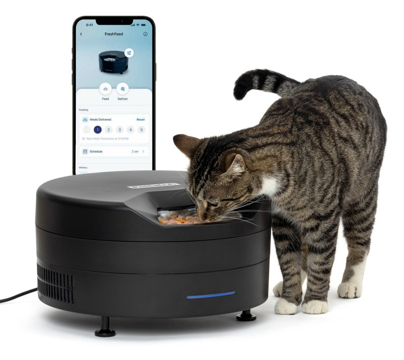
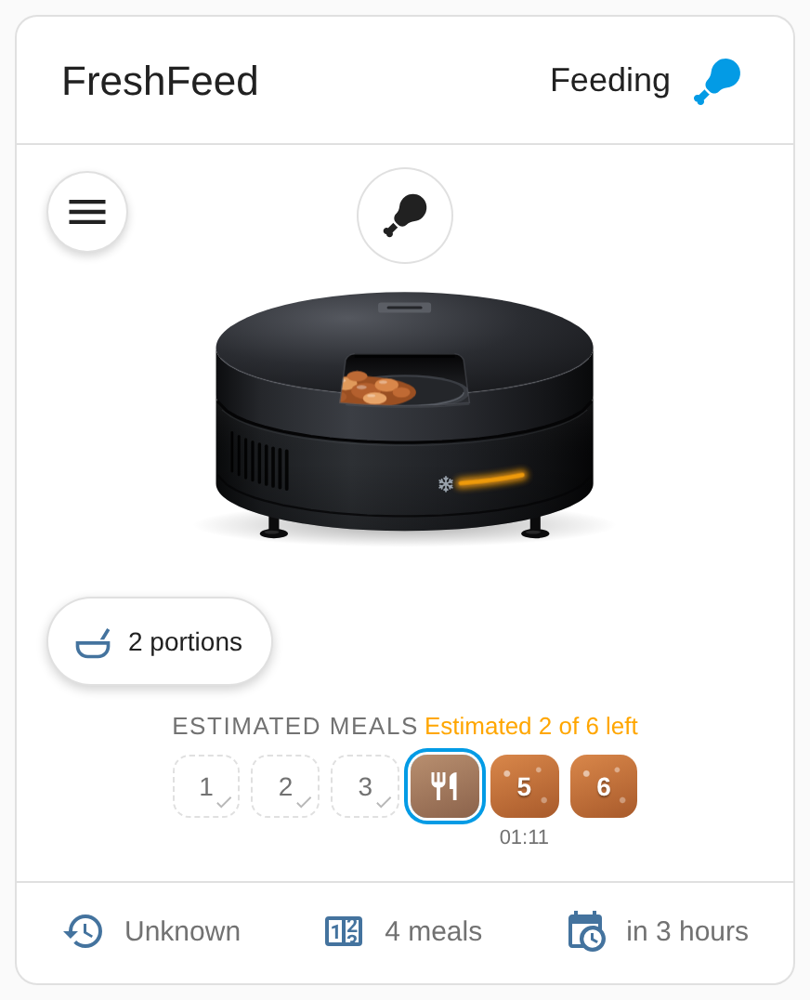

# PetSafe FreshFeed

 

Developer notes: [docs/DEVELOPMENT.md](docs/DEVELOPMENT.md).

Home Assistant integration, version **0.5.2**, that controls a PetSafe FreshFeed feeder
directly on your local network (local protocol 3.5, pinned `tinytuya==1.20.0`, which
Home Assistant installs). Requires Home Assistant `2026.10.0` or later. Independent
community software, not affiliated with PetSafe; the project icon is original artwork.

Only first Wi-Fi pairing and firmware updates need the official PetSafe app.

## Installation

In HACS, add `https://github.com/sudolulo/petsafe-freshfeed` as a custom repository
(category **Integration**) and download it, or copy `custom_components/petsafe_freshfeed`
into your `custom_components` folder. Restart Home Assistant.

Home Assistant installs one TinyTuya shared by every integration. If another
integration needs a different version, this entry stays unavailable
(`owned_source_incompatible`) rather than run unchecked code.

## Sign in and setup

1. Add **PetSafe FreshFeed** under Settings > Devices & services.
2. Sign in with your PetSafe account. Regions: 1 (Americas), 44 (Europe), 91 (India)
   and 7 (Russia).
3. Choose the feeder. The integration finds it on the LAN or asks for its private IPv4
   address, and one read-only status check must succeed before anything is saved. The
   entry starts read-only.

If sign-in is not available in this installation, setup stops; there is no fallback.
Setup also stops if another enabled integration holds the feeder's local connection.
Entries that used the removed Tuya Local connection method fail to start with a clear
message, and nothing is changed. **Reconfigure** changes only the address.

**Cloud reads.** Sign-in and cloud reads are read-only; every command is local. New
setups turn cloud reads on: when the feeder has not reported its quick-feed state or
schedule since connecting, the integration reads them on demand, at most once per 60
seconds. **Fully local** (entry Configure options) turns this off and deletes the
stored cloud session (sid and ecode). Upgraded entries start Fully local. A valid
session is restored after a restart; if it is rejected or cannot be restored, Repairs
asks you to sign in again through Home Assistant while local operation continues.

**Privacy.** Sign-in and optional reads contact the PetSafe/Tuya API for your region with fixed technical headers. Sign-in attempts are limited to one per 60 seconds. Your password is never stored, nor your email. The device ID, local key,
address and cloud session are stored unencrypted in the config entry, like other Home
Assistant entries, and kept out of logs and diagnostics. Whether sign-in signs the
phone app out has not been checked.
Make a full Home Assistant backup and keep it secret; it contains the local key.

## Entities

| Group | Examples and interpretation |
|---|---|
| Status | Status, Compartment, Quick feed, Defrost remaining, Defrosting, Write status; unknown means not reported. |
| Estimates | Estimated meals remaining, Estimated food level: from compartment position assuming a refilled tray, not measured food. Next meal is a schedule projection, not a device promise. |
| Schedule | Schedule, reported locally or labelled "Read from the PetSafe cloud". A last-known plan stays editable; unknown is not an empty plan. |
| History/statistics | History, Last fed, Last feed result, Meals today, Observed meals dispensed total: local observations only, no backfill, excluding offline gaps and cloud history. |
| Connectivity | Connected, Last report: observations available, not a guarantee of command success. |
| Faults | Fault (reported) and Estimated empty tray (estimate). |
| Events | Feeding: seven observed event types, also device triggers; not proof of consumption. |
| Settings | Stainless inserts, Meal counter, Display brightness (opt-in, guarded). Diagnostic: Brightness, Firmware version, Hardware version, Quick feed state. |

Statistics start at zero without backfill; abrupt power loss can lose unsaved increments.

## Controls

Choose **Enable controls** in the entry's Configure options. Feed, Cancel, Defrost
and Refilled require explicit confirmation. Command, recovery and schedule-save
services require an authenticated administrator; automations without a user context
cannot call those services. Schedule saves and setting changes do not require
explicit confirmation. Settings use normal Home Assistant entity access. Each command is
sent once, never retried, and confirmed only by the feeder's own local report, never
by a cloud reading. A report is not proof of physical feeding. Feed is refused on an
empty tray. Cancel needs a reported pending quick feed and is not an emergency stop.

If the feeder has never reported its quick-feed state since connecting, Feed, Defrost,
Refilled and settings need local reports from the last 35 seconds showing a resting
status, no defrost and a valid compartment, even with a cloud reading. Active or invalid
cloud readings block these commands, including after expiry until superseded locally or
reconnection. Once the feeder has reported its quick-feed state locally, the latest local
report decides: an active or invalid value blocks these commands, and a later idle report
allows them again under the same freshness and safety checks.
A pending quick feed the feeder never reported could result in an extra meal.
The same applies when cloud reads fail or are out of date.

**Schedule.** Saving sends the whole schedule (up to 10 rows). Revision checks detect
changes the integration has observed since loading, not every external change. If an
external writer changes the schedule before its update arrives, that change can be
overwritten. A cloud plan is not an acknowledgement of a save; a later local
report replaces it. In Fully local mode a never-observed schedule stays unknown and
cannot be viewed or replaced; turn on cloud reads to retrieve it. The card's
five-minute near-meal warning is advisory and does not block saving.

Services: `petsafe_freshfeed.command`, `petsafe_freshfeed.save_schedule` (pass the
Schedule `revision` as `base_revision`) and `petsafe_freshfeed.recover` (the
`operation_id` and `session_id` from Write status).

## Recovery

After a restart or an unconfirmed command, controls stay locked until you inspect the
feeder and choose recovery. Recovery never sends a command; it watches fresh local
reports for up to 35 seconds. Strict recovery clears the lock only when the required
operation-specific evidence and safety checks pass. With explicit administrator
confirmation, fresh safe local reports, including an empty status, may instead allow
local abandonment, execution unknown: this does not prove whether the
old command ran or that the tray was filled. New commands are checked separately.

## Troubleshooting

- Check Settings > System > Repairs and download the integration's redacted diagnostics.
- Unavailable: check feeder power, the LAN and its address, then **Reconfigure**.
- Uncertain command: inspect the feeder and use recovery.
- Do not delete or reset storage, or repeat a possibly sent command.

## Blueprints

HACS does not automatically install root blueprints; import them or copy the YAML into
`/config/blueprints/automation/petsafe_freshfeed/`. They notify or update helpers, not
feeder commands. Links are source locations, not a claim of publication.

- Low estimated meals: [source](https://raw.githubusercontent.com/sudolulo/petsafe-freshfeed/trunk/blueprints/automation/petsafe_freshfeed/low_estimated_meals.yaml) / [import](https://my.home-assistant.io/redirect/blueprint_import/?blueprint_url=https%3A%2F%2Fraw.githubusercontent.com%2Fsudolulo%2Fpetsafe-freshfeed%2Ftrunk%2Fblueprints%2Fautomation%2Fpetsafe_freshfeed%2Flow_estimated_meals.yaml)
- Feeder attention: [source](https://raw.githubusercontent.com/sudolulo/petsafe-freshfeed/trunk/blueprints/automation/petsafe_freshfeed/feeder_attention.yaml) / [import](https://my.home-assistant.io/redirect/blueprint_import/?blueprint_url=https%3A%2F%2Fraw.githubusercontent.com%2Fsudolulo%2Fpetsafe-freshfeed%2Ftrunk%2Fblueprints%2Fautomation%2Fpetsafe_freshfeed%2Ffeeder_attention.yaml)
- Refill/cleaning: [source](https://raw.githubusercontent.com/sudolulo/petsafe-freshfeed/trunk/blueprints/automation/petsafe_freshfeed/refill_cleaning_reminder.yaml) / [import](https://my.home-assistant.io/redirect/blueprint_import/?blueprint_url=https%3A%2F%2Fraw.githubusercontent.com%2Fsudolulo%2Fpetsafe-freshfeed%2Ftrunk%2Fblueprints%2Fautomation%2Fpetsafe_freshfeed%2Frefill_cleaning_reminder.yaml)

The optional [Pet Feeder Card](https://github.com/sudolulo/pet-feeder-card) is a separate
distribution. Issues: https://github.com/sudolulo/petsafe-freshfeed/issues. MIT licensed;
see [LICENSE](LICENSE) and [NOTICE](NOTICE).
